# Smart Sweep SWMS — workflows

How work actually moves through the system: the operational chain from a new
city to reconciled cash, who does each step, and which API calls each one
makes.

Companion documents: [API reference](API-REFERENCE.md) ·
[User manual](USER-MANUAL.md)

---

## Contents

- [The operational chain](#the-operational-chain)
- [Who does what](#who-does-what)
- [W0 · Setting up a city](#w0--setting-up-a-city)
- [W1 · Registering holdings](#w1--registering-holdings) — bulk upload, the editor, surveys
- [W2 · Location verification](#w2--location-verification)
- [W3 · Route planning and assignment](#w3--route-planning-and-assignment)
- [W4 · The daily collection round](#w4--the-daily-collection-round)
- [W5 · Working offline](#w5--working-offline)
- [W6 · Closing the collection day](#w6--closing-the-collection-day)
- [W7 · Complaint lifecycle](#w7--complaint-lifecycle)
- [W8 · Monthly billing run](#w8--monthly-billing-run)
- [W9 · Payment collection](#w9--payment-collection)
- [W10 · Cash hand-in, remittance and reconciliation](#w10--cash-hand-in-remittance-and-reconciliation)
- [W11 · Fleet upkeep](#w11--fleet-upkeep)
- [W12 · Live map and telemetry](#w12--live-map-and-telemetry)
- [W13 · City monitoring](#w13--city-monitoring)
- [The monthly cycle](#the-monthly-cycle)
- [Rules the server enforces](#rules-the-server-enforces)

---

## The operational chain

**Everything is holding-wise.** A holding — a building — is the unit that is
charged, billed, paid for, collected from and scanned. Its households are the
families living in it, recorded for the register and for the rule that
households must equal units.

Every holding follows the same path. Each arrow is a gate — the next step is
refused until the previous one is complete.

```mermaid
flowchart LR
    A[Holding registered<br/>import · editor · survey] -->|service terms| B[Signed up<br/>tier / charge]
    B -->|verify GPS| C[Verified<br/>routable]
    C -->|add to route| D[On a route]
    D -->|assign collector| E[On a round]
    E -->|confirm, or cut-off| F[Collected<br/>confirmed or auto]
    F -->|billing run| G[Billed]
    G -->|record payment| H[Paid]
    H -->|hand in cash| I[Deposited]
    I -->|remit, reconcile| J[Reconciled]

    style A fill:#e8f0e4,stroke:#5a7a4a
    style C fill:#e8f0e4,stroke:#5a7a4a
    style F fill:#e8f0e4,stroke:#5a7a4a
    style H fill:#e8f0e4,stroke:#5a7a4a
    style J fill:#d4e5cc,stroke:#3d5c30
```

The gates worth knowing before anything else:

1. **An unverified holding cannot be routed.** Location verification is not
   advisory — the server refuses.
2. **A holding is collected unless someone complains.** At the city's cut-off,
   every due holding nobody confirmed and nobody complained about is recorded as
   collected automatically.
3. **A holding without a charge is not billed.** No tier and no agreed charge
   means it has not been signed up.
4. **A bill's status only changes when a payment is recorded.** There is no
   "mark as paid".

---

## Who does what

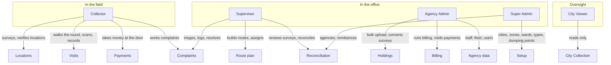

| Role | Owns | Cannot |
|---|---|---|
| **Collector** | Their own round, surveys, location verification, door payments, and complaints in their ward | See another collector's round; run billing; void a payment; upload holdings |
| **Supervisor** | Their zone's wards end to end — routes, assignments, complaints, survey review, reconciliation | Issue bills; void a payment; change setup or agencies |
| **Agency Admin** | Everything for **their agency** — holdings (incl. bulk upload), staff, fleet, billing, users | See or change another agency's records; change setup |
| **Super Admin** | Every city and agency; setup (cities, zones, wards, type lists, dumping points, tiers); agencies and remittances | — |
| **City Viewer** | Reading one city (or all) — City Collection and reports | Write anything |

---

## W0 · Setting up a city

*Super Admin.* A second city is new rows, not a second deployment.

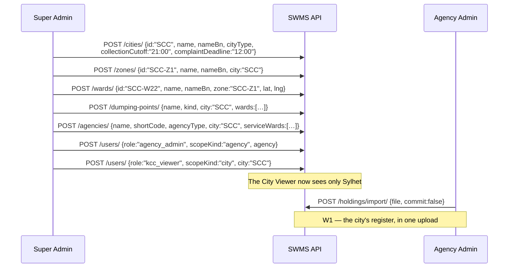

**Codes are shared by every city.** Zone and ward ids are primary keys printed
on material, so a new city prefixes its own (`SCC-Z1`, `SCC-W22`).

**Types are setup rows.** City types (City Corporation, Pourashova) and agency
types (private, NGO, CBO, cooperative, in-house) are edited in Setup without a
release; a type in use cannot be deleted, only hidden.

**An agency stays inside its city.** Its service wards, and a van's dumping
point, must belong to the same city — the server refuses otherwise.

---

## W1 · Registering holdings

Three ways in, all ending at the same place: a holding with its families and,
once signed up, its service terms.

### Bulk upload — the minimum-effort route

*Agency Admin, Super Admin.*

```mermaid
sequenceDiagram
    participant A as Admin
    participant API as SWMS API

    A->>API: GET /holdings/import-template/
    API-->>A: holdings-upload-template.xlsx
    A->>API: POST /holdings/import/ {file, commit:false}
    API-->>A: {summary{valid, invalid, toCreate, toUpdate}, rows[{row, status, errors, warnings}]}
    Note over A: Fix rows with errors in the sheet, check again
    A->>API: POST /holdings/import/ {file, commit:true}
    API-->>A: {summary{created, updated}, rows}
    Note over API: Valid rows in one transaction;<br/>invalid rows skipped, never half-written
```

Columns: Holding No, Name, Mobile, City, Ward, Area, Address, Route, GPS Location
(+ Holding Type, Tier, Charge, Units, Agency). A new **Area** is added to the
ward; **GPS** verifies the building; **Route** puts it at the end of that walk
(it needs GPS); a row matching an existing holding **updates** it.

### The Holding editor

`POST /holdings/` (or `PATCH /holdings/{id}/`) with the building, its **service
terms** (`tier`, `charge`, `paymentMode`, `paymentDay`) and its families in one
save:

```json
{ "ward": "W-14", "road": "KDA Avenue", "holdingNo": "142/B", "holdingType": "multi_storey",
  "ownerName": "…", "unitsTotal": 4, "tier": "residential_standard", "charge": 0,
  "paymentMode": "cash", "paymentDay": 5,
  "households": [ {"head": "…", "unit": "1A"}, {"id": "HH-KCC-…", "head": "…", "unit": "1B"} ] }
```

**Households must equal units.** More active families than `unitsTotal` is
refused; fewer is allowed and flagged (`unitsMatch: false`,
`?unitsMismatch=true`). A family that moved out is set inactive, which frees its
unit. The building's QR tag is issued on create.

### Survey to holding

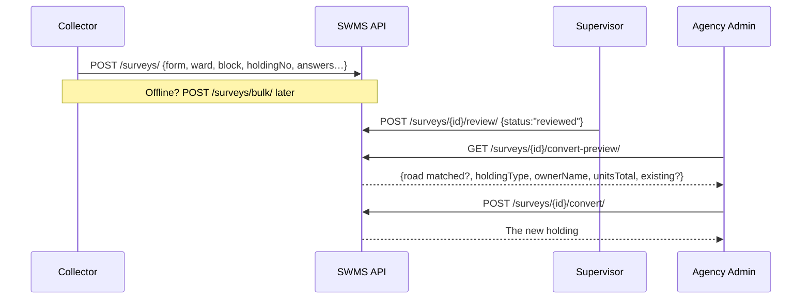

A surveyed family that is not yet paying ("potential customer") is brought under
service with `POST /potential-customers/{id}/convert/` — the household is
created in the holding and the **tier, charge, payment mode and day land on the
holding**. The survey is closed, not deleted, so `GET /reports/customer-funnel/`
keeps its history.

---

## W2 · Location verification

The gate that controls everything downstream.

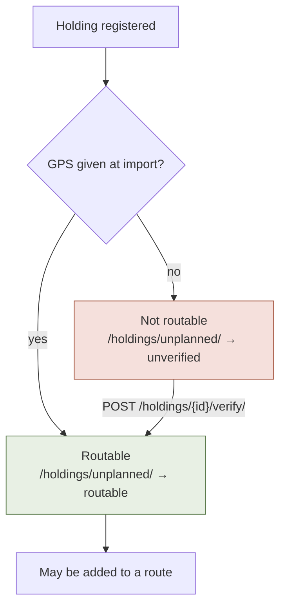

A building has **one** pin; its families read it through. Two ways it gets set,
kept distinct because their accuracy differs:

| `placedByHand` | Who | Meaning |
|---|---|---|
| `false` | Collector | A GPS fix taken standing at the door, with an `accuracy` in metres |
| `true` | Office user, or a bulk upload | Dropped on a map, or taken from the register |

---

## W3 · Route planning and assignment

A route walks **buildings**: `stops` are holding ids.

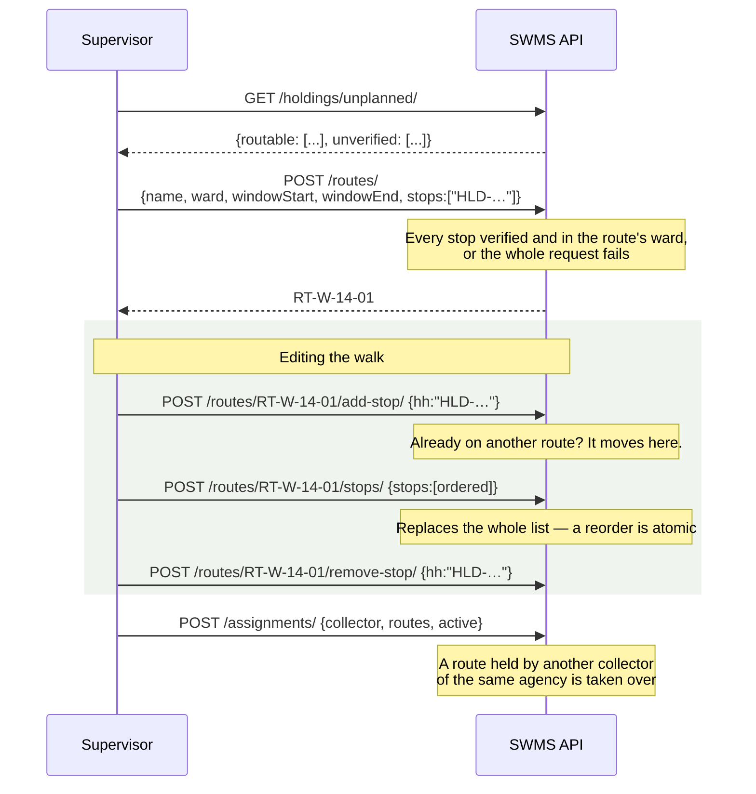

**Use `POST /stops/` for a drag-reorder**, so the route is never briefly
half-ordered. **Reassignment is permissive within an agency** — dragging a
holding or a route is normal planning — but a route is never taken from another
agency's collector.

---

## W4 · The daily collection round

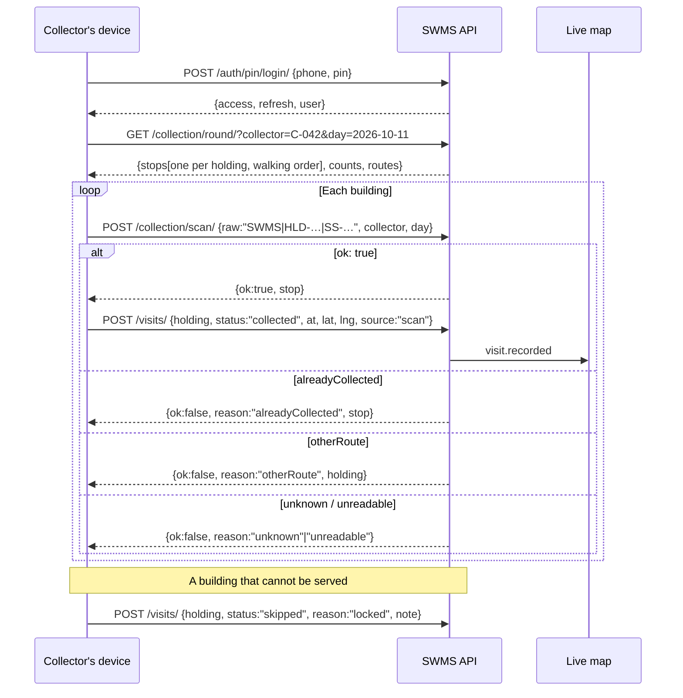

**One stop, one scan, one visit per building**, however many families live in
it; the stop's `units` says how many. **Confirming is optional** — a holding
nobody confirms is still collected at the cut-off unless it complains (W6) — but
confirmed visits are counted apart, so an agency that confirms its work can show
it.

**A scan never fails the request.** All five outcomes come back as 200.

**Skip reasons** are a fixed set: `noOne`, `noWaste`, `locked`, `access`,
`refused`. A skip without one is rejected.

**Correcting a skip.** Re-post the same holding for the same day with
`status: "collected"`. The unique constraint on `(holding, served_on)` means the
existing row is **updated**, not duplicated.

**A collector cannot look at someone else's round.** Passing another
`collector=` returns their *own* round rather than a 403.

---

## W5 · Working offline

Coverage in the field is unreliable, so a round — and a survey — has to be
walkable with no connection at all.

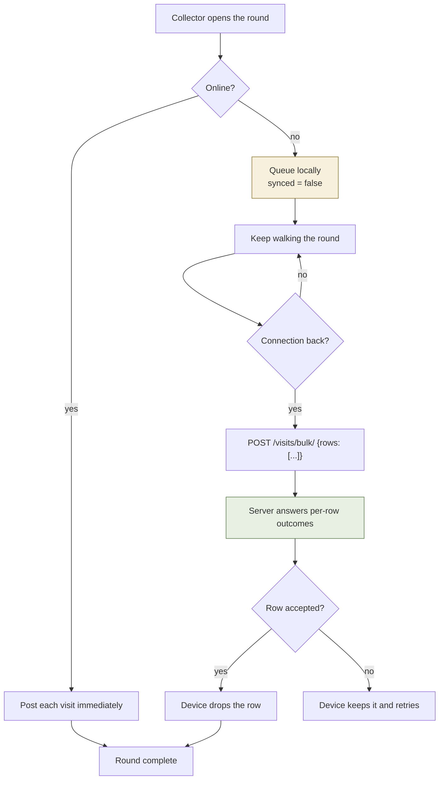

**The bulk endpoints answer with per-row outcomes, not one status code**, so one
bad row never rejects the rest. Replaying a row the server already has updates
it instead of creating a duplicate, so a retry is always safe. Surveys work the
same way through `POST /surveys/bulk/`.

---

## W6 · Closing the collection day

*Automatic.* The client's rule: **a holding is collected unless someone
complains.**

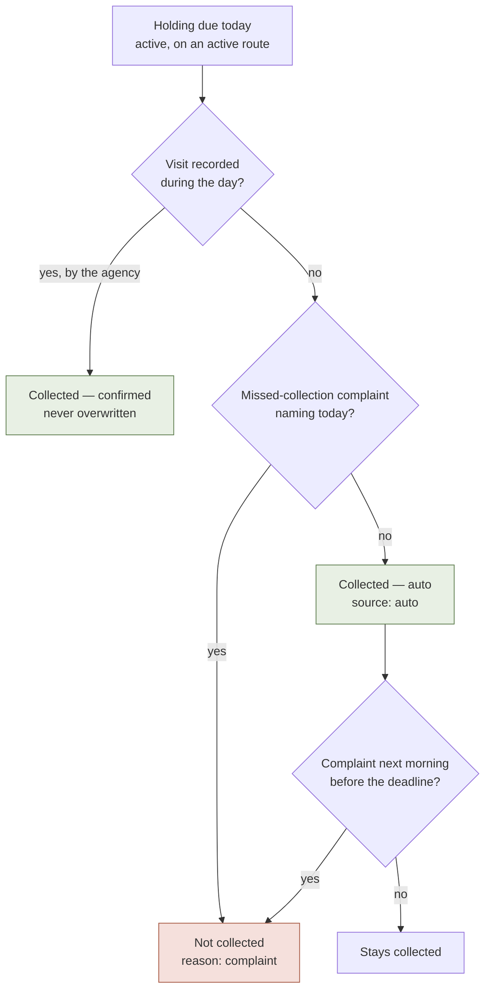

The close runs at each city's **`collectionCutoff`** (21:00 by default) through
a management command the server's scheduler calls every 15 minutes:

```
python manage.py close_collection_day [--city KCC] [--date YYYY-MM-DD] [--dry-run]
```

It is safe to repeat. Without `--date` it closes yesterday (in case the server
was down) and, once past the cut-off, today. Each close rebuilds a **daily
summary** per city, ward and agency — `due`, `confirmed`, `auto`, `missed`,
`skipped`, `complaints` — which [W13](#w13--city-monitoring) reads.

A late complaint (until the city's **`complaintDeadline`**, 12:00 the next day by
default) turns that holding's **auto** visit into not collected and rebuilds the
summary at once. A visit the agency confirmed is never overturned by a
complaint — the complaint stays on the queue for a supervisor to settle.

---

## W7 · Complaint lifecycle

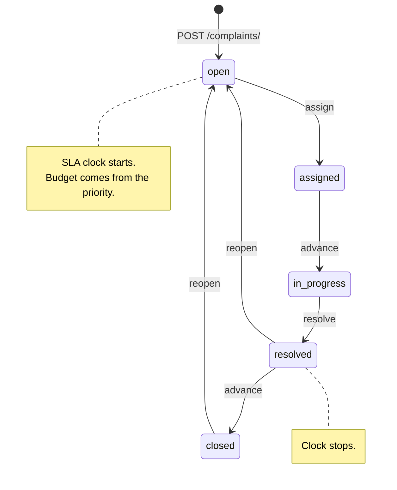

A complaint is about a **holding**, optionally naming the **household** that
reported it:

```json
{ "holding": "HLD-KCC-000123", "household": "HH-KCC-0012840",
  "type": "missed_collection", "missedOn": "2026-10-10", "priority": "high", "note": "…" }
```

**A missed collection names a day.** `missedOn` is today by default, or yesterday
until the city's complaint deadline (`missed_on_too_late`,
`missed_on_out_of_range`). It is what turns that holding's day into *not
collected* — before the cut-off the close sees it; after, it flips the auto visit
immediately.

**Status is never a field write.** Every lifecycle move is its own endpoint, and
each one appends an immutable `ComplaintActivity` row.

| Action | Endpoint | Also does |
|---|---|---|
| Assign | `POST /{id}/assign/` | `{"assigned": null}` returns it to the pool |
| Advance | `POST /{id}/advance/` | Follows `nextStatus` on the ticket |
| Re-grade | `POST /{id}/priority/` | **Changes the SLA budget, so the clock moves** |
| Resolve | `POST /{id}/resolve/` | Stops the clock, records how |
| Reopen | `POST /{id}/reopen/` | Restarts the clock |
| Note | `POST /{id}/note/` | Trail only; ticket unchanged |
| Photos | `POST /{id}/photos/` | Multipart; all files validated before any is stored |

**Collectors may run every one of these** in their own ward; a City Viewer is
refused.

### SLA budgets

| Priority | Budget |
|---|---|
| `urgent` | 4 hours |
| `high` | 12 hours |
| `medium` | 24 hours |
| `low` | 48 hours |

---

## W8 · Monthly billing run

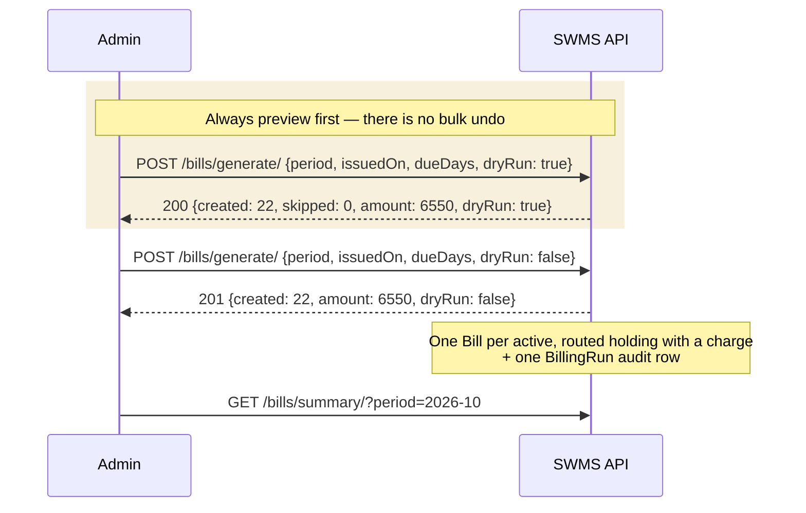

**One bill per holding per month**, for its `effectiveCharge` (the agreed charge,
else the tier's). A holding with no tier and no charge is not billed.

**A bill can only come from a run.** `POST /api/bills/` answers 400
`use_billing_run` for everyone but a superuser. Re-running a period is safe —
holdings already billed come back in `skipped`.

`dueDays` (default 10) sets `dueOn`, which makes a bill *overdue* rather than
merely *unpaid*.

---

## W9 · Payment collection

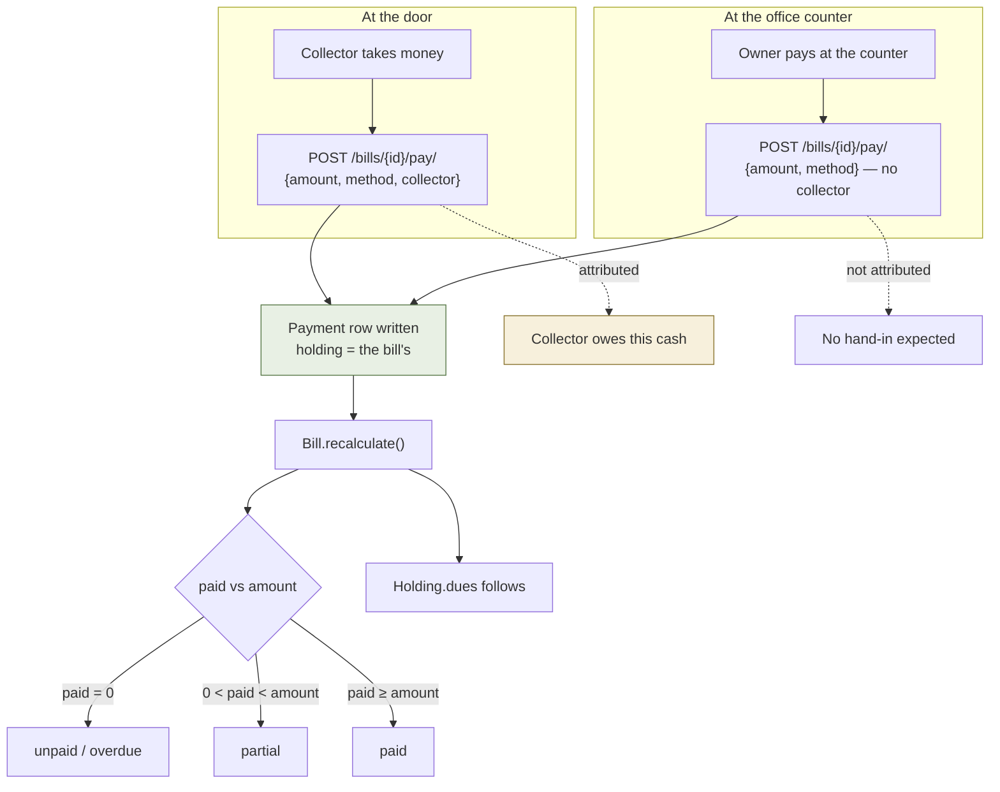

**Recording a payment is the only thing that moves a bill.** `Bill.status` is a
cache derived from the payments that exist; `Holding.dues` follows from that.

**Partial payments are normal.** **Whether `collector` is set is what makes
reconciliation possible.** **A payment's period is the month it was *taken*
in**, not the month its bill covers.

**Corrections.** `POST /payments/{id}/void/` (admins only), then re-record it.
Voiding restates the bill from the payments that remain.

---

## W10 · Cash hand-in, remittance and reconciliation

The money moves in three hops: the owner pays a collector (**payment**), the
collector hands the cash to their agency (**deposit**), and the agency remits it
to the corporation (**remittance**).

```mermaid
sequenceDiagram
    participant C as Collector
    participant S as Supervisor
    participant SA as Super Admin
    participant API as SWMS API

    C->>API: POST /deposits/record/<br/>{collector, period, method, amount, ref}
    Note over API: Upsert per collector and month;<br/>links the payments it covers

    S->>API: GET /deposits/cash-position/?period=2026-10
    API-->>S: per collector: collected vs deposited vs variance
    S->>API: GET /reports/reconciliation/?period=2026-10
    API-->>S: {service, cash, cashTotals, exceptions}
    Note over S: Served-not-billed, billed-not-served,<br/>paid-not-served — per holding

    SA->>API: POST /remittances/record/ {agency, period, method, amount, ref}
    SA->>API: GET /remittances/cash-position/?period=2026-10
    API-->>SA: per agency: collected → deposited → remitted
```

**Deposits are deliberately not ward-scoped** — a hand-in is a fact about a
collector and a month. **Several remittances a month are normal** — each bank
transfer is its own document. **The reconciliation exceptions are the
deliverable**: they list holdings, not totals.

---

## W11 · Fleet upkeep

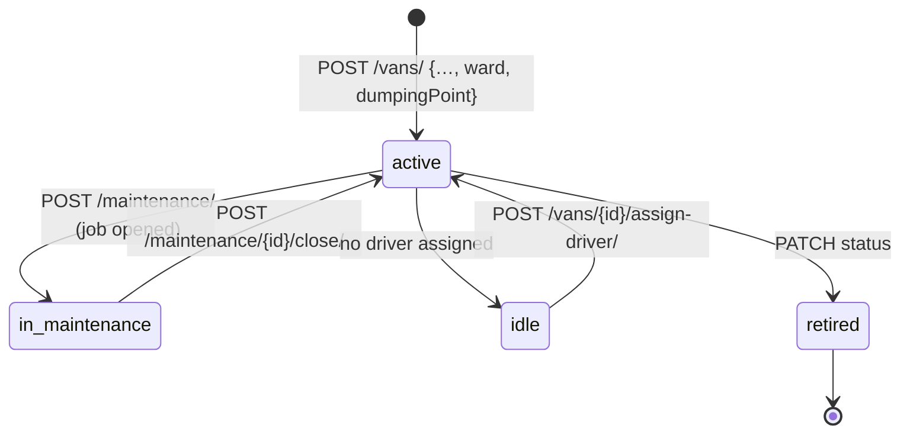

A van works a **ward** and unloads at a **dumping point** — which must be in the
ward's city. **Opening a maintenance job takes the van off the road**; closing it
computes downtime and frees the van. **Assigning a driver releases them from any
other van.** `GET /vans/alerts/` returns expiring paperwork and service-due
warnings against today; `GET /vans/kpis/` the fleet figures.

---

## W12 · Live map and telemetry

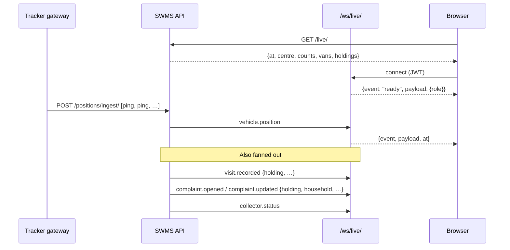

Pins are **holdings** — collection and dues are holding-wise. **A dropped map
update never fails the write that produced it.** Clients that cannot use
websockets poll `GET /live/`. Multi-process realtime needs `REDIS_URL`.

---

## W13 · City monitoring

*City Viewer, and the office.* The City Corporation watches its city; it does not
run daily operations.

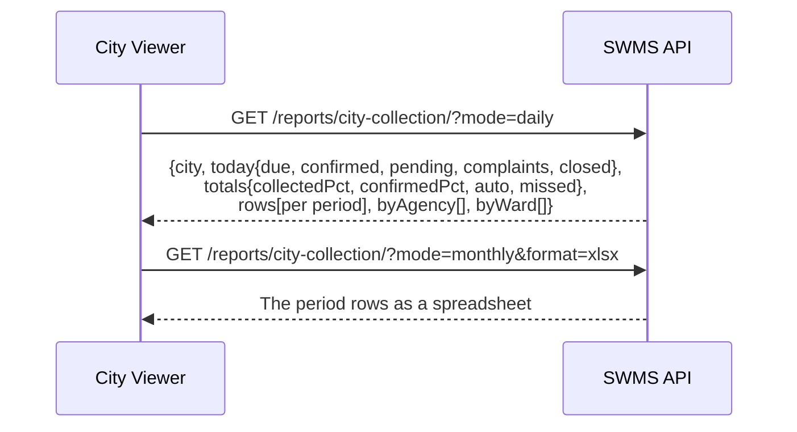

Closed days come from the daily summary written by W6; **today** is counted live
until its cut-off. A City Viewer whose account names a city always gets that
city; others may pick any city holding a ward they can see. The three kinds of
"collected" — confirmed, auto, missed — are kept apart **by agency**, so the
city can see which contractors prove their work.

---

## The monthly cycle

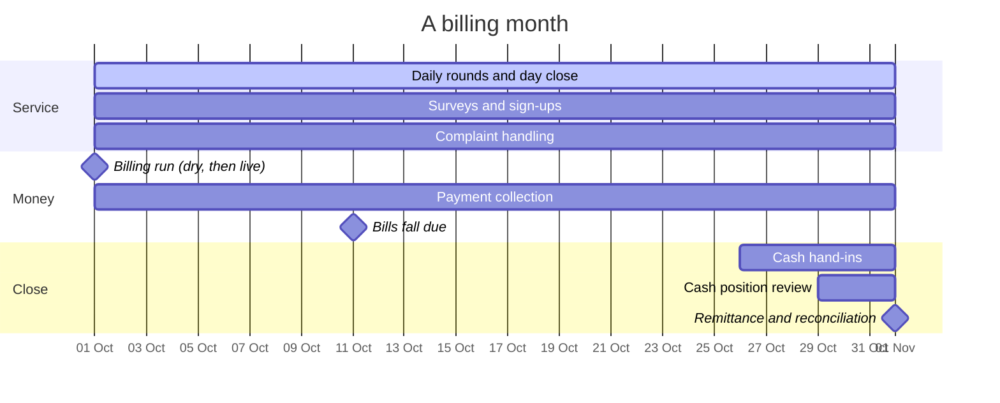

| When | Who | Does |
|---|---|---|
| Month start | Admin | Dry-run then run `POST /bills/generate/` |
| Daily | Collector | Walk the round; confirm visits; take payments |
| Daily, at the cut-off | Server | `close_collection_day` — uncomplained holdings collected |
| Daily | Supervisor | Triage complaints; review rounds; fix routes |
| Daily | City Viewer | Watch City Collection |
| Ongoing | Collector · Admin | Survey; verify locations; upload and sign up holdings |
| `issuedOn + dueDays` | — | Unpaid bills become **overdue** |
| Month end | Collector | `POST /deposits/record/` |
| Month end | Supervisor | `cash-position`, then `/reports/reconciliation/` |
| Month end | Super Admin | `POST /remittances/record/` |
| Month end | Admin | `POST /collectors/refresh-metrics/` |

---

## Rules the server enforces

These are not client-side conventions. Each is enforced in the API, and working
around them is not possible from the frontend.

| Rule | Where | Consequence of ignoring it |
|---|---|---|
| Every operation is per holding | Bill, Payment, Visit, Complaint link to the holding | A household has no charge, bill, visit or QR |
| Households must equal units — never more active ones | Holding / household save | 400 under `unitsTotal` / `holding` |
| An unverified holding cannot go on a route | Route create / add-stop | Request fails |
| A holding is collected unless it complains | `close_collection_day` at the cut-off | Auto visit written; a complaint makes it not collected |
| A complaint can name yesterday only until the deadline | `check_missed_on` | 400 `missed_on_too_late` |
| A confirmed visit is never overwritten by the close or a complaint | `close_day`, `record_missed` | The complaint stays on the queue |
| A bill comes only from a billing run, for a holding with a charge | `POST /bills/`, `generate_bills` | 400 `use_billing_run`; unsigned holdings skipped |
| A bill's status changes only via a payment | `Bill.recalculate()` | No endpoint exists to do otherwise |
| One visit per holding per day | DB unique constraint | A re-post updates, never duplicates |
| A complaint's status is not writable | `PATCH` excludes it | The move must go through an action |
| A collector sees only their own round | `own_round_only()` | Another `collector=` is silently replaced |
| Scope comes from the account — ward, agency, city | `visible_ward_ids()`, `visible_agency_id()` | A query parameter cannot widen it |
| An agency's wards and a van's dumping point stay in one city | Agency / van save | 400 |
| Setup and agencies are super admin only | `SUPER_ADMINS` | 403 |
| Only an admin voids a payment, runs billing or uploads holdings | `ADMIN_WRITERS` | 403 |
| Reassigning a route or stop is allowed within an agency | `set_routes`, `add_stop` | The old link is dropped; across agencies it is refused |
| Tonnage is an estimate | `waste_by_zone` | Every row carries `estimated: true` |
| A stale map update never fails a write | `publish()` | Broadcast errors are logged and swallowed |
